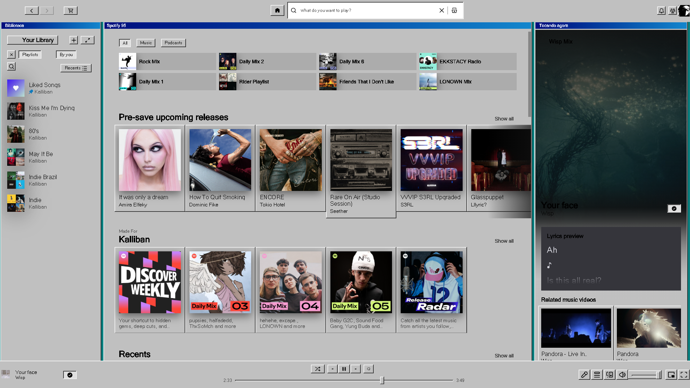
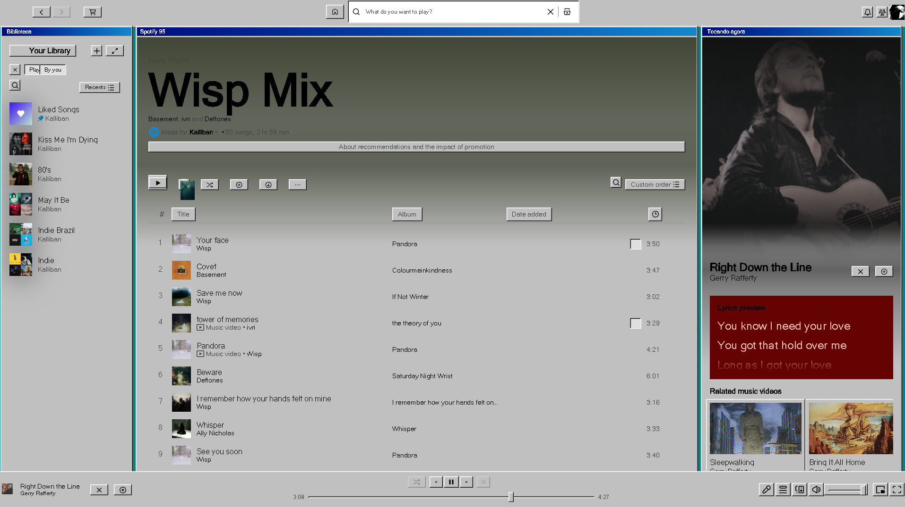
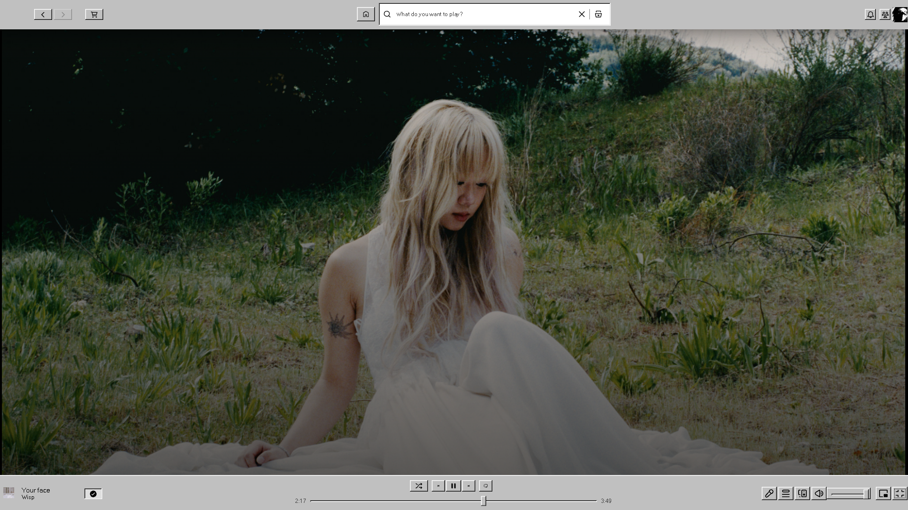
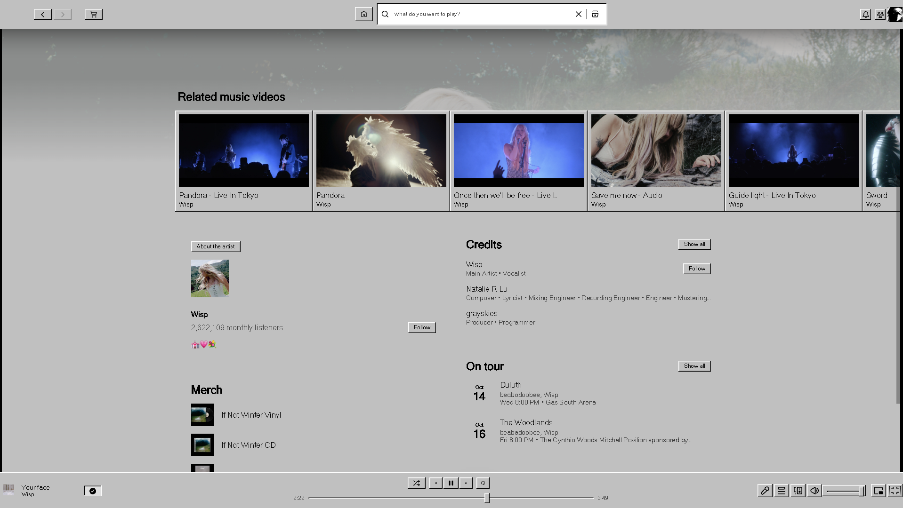

# Windows 95 — tema para Spicetify

Deixa o Spotify com o visual clássico do Windows 95: área de trabalho verde-azulada, painéis como janelas cinza em relevo, barras de título azuis, botões que "afundam" ao clicar, sliders com pegador retangular e barras de rolagem quadriculadas.

### Home


### Playlist


### Tocando agora (tela cheia)


### Detalhes da música


## Instalação

### Pelo Marketplace (recomendado)
1. Abra o **Marketplace** no Spotify.
2. Vá na aba **Themes** e procure por **Windows 95**.
3. Clique em **Install**.

### Manual
1. Descubra a pasta de configuração do Spicetify:
   ```bash
   spicetify config-dir
   ```
2. Crie a pasta `Themes/Windows95` dentro dela e copie `user.css` e `color.ini` para lá.
3. Aplique:
   ```bash
   spicetify config current_theme Windows95 color_scheme base
   spicetify apply
   ```

## Esquema de cores

| Variável | Cor | Uso |
|---|---|---|
| `main` / `sidebar` / `player` / `card` | `#C0C0C0` | Cinza das janelas |
| `text` | `#000000` | Texto |
| `highlight` / `selected-row` / `button` | `#000080` | Azul-marinho de seleção |
| `button-active` | `#1084D0` | Fim do degradê da barra de título |
| `notification` | `#FFFFE1` | Amarelo das dicas (tooltips) |

## Fontes
O tema usa `MS Sans Serif` / `Microsoft Sans Serif` quando disponíveis (Windows) e cai para `Tahoma` / `Geneva` no macOS.

## Aviso
O tema estiliza classes internas do Spotify. Atualizações do Spotify podem quebrar alguma parte do visual. Se isso acontecer, rode `spicetify update` e `spicetify apply` e, se o problema continuar, abra uma issue com um print.

## Licença
MIT
